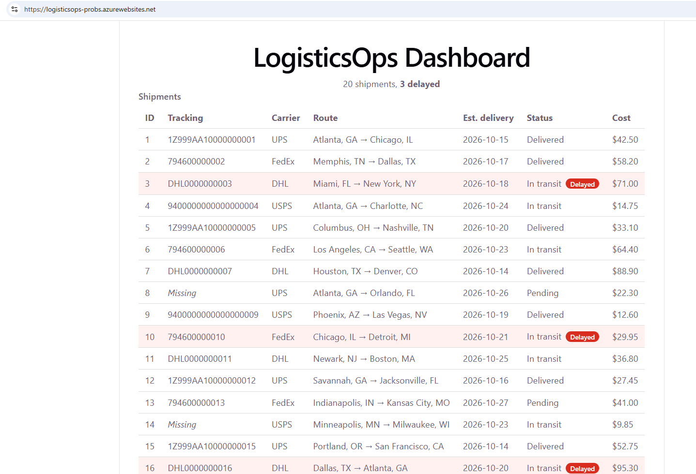

# LogisticsOps Dashboard

A lightweight shipment-monitoring dashboard modeled on an internal
transportation management system (TMS). It lists shipments and flags
those that are past their estimated delivery date and not yet delivered.

**Live demo:** https://logisticsops-probs.azurewebsites.net
(Hosted on Azure App Service's free tier, so the first load may take a
moment while the app starts.)



## Features (current)

- ASP.NET Core Web API serving shipment data (`GET /api/shipments`,
  `GET /api/shipments/{id}`)
- Delay detection computed from dates, so it never goes stale
- React + TypeScript dashboard with a shipment table and "Delayed" indicator
- Single deployable app: the API serves the built React files
- Simulated data only (20 shipments across UPS, FedEx, DHL, USPS),
  held in memory and regenerated relative to today's date on startup

## Tech stack

- Backend: C#, ASP.NET Core Web API (.NET 10), dependency injection
- Frontend: React, TypeScript, Vite
- Hosting: Azure App Service (Free F1), deployed with Azure CLI

## Run locally

Requirements: .NET 10 SDK, Node.js 20+ (developed on Node 24), Git.

```powershell
# Terminal 1: API
cd backend/LogisticsOps.Api
dotnet run

# Terminal 2: frontend with hot reload (proxies /api to the API)
cd frontend
npm install
npm run dev
```

Open http://localhost:5173. The API alone runs at http://localhost:5024.

## Build and deploy

```powershell
cd frontend
npm run build                      # outputs to backend/LogisticsOps.Api/wwwroot
cd ../backend/LogisticsOps.Api
dotnet publish -c Release -o ../../publish
cd ../..
tar -a -c -f publish.zip -C publish .
az webapp deploy --resource-group rg-logisticsops --name <app-name> --src-path publish.zip --type zip
```

## Project structure

```
backend/LogisticsOps.Api/   ASP.NET Core API (Controllers, Models, Data)
frontend/                   React + TypeScript (Vite)
```

## Roadmap

- [ ] SQL Server database with EF Core migrations
- [ ] Search, filtering, add/edit shipments
- [ ] Exception detection (missing tracking, late deliveries)
- [ ] Reporting by carrier
- [ ] Unit tests (xUnit) and GitHub Actions CI

## Limitations

Data is simulated and stored in memory, so changes are not saved across
restarts. There is no authentication.